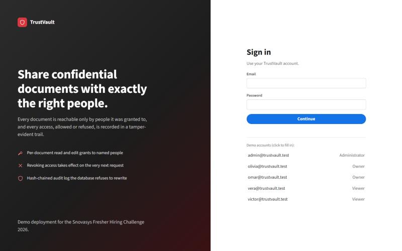
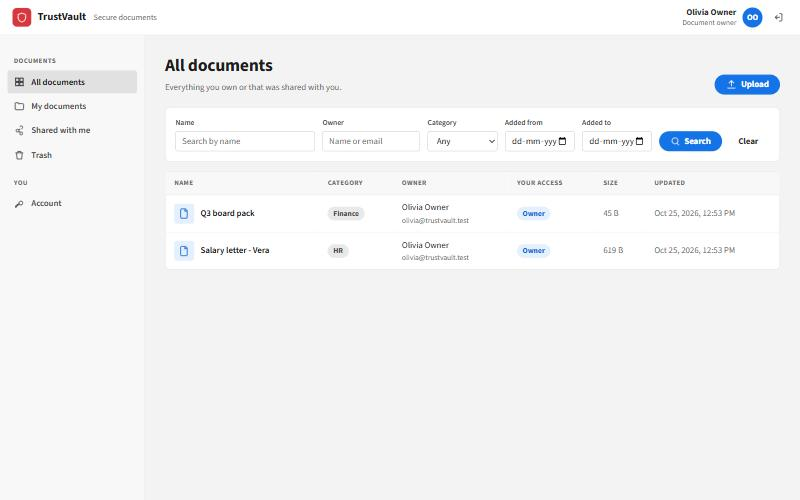
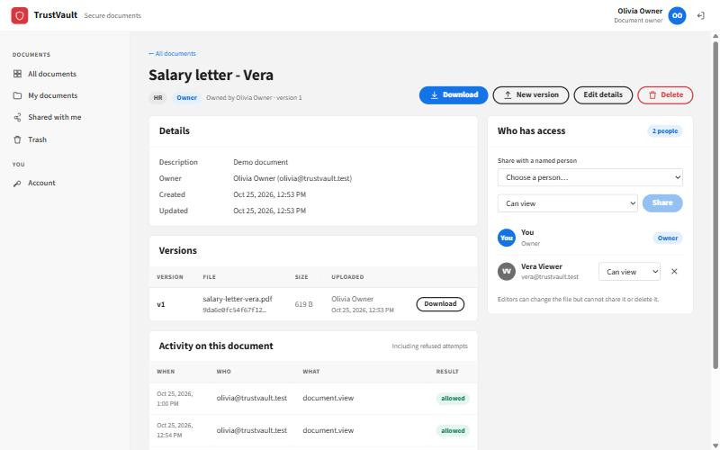
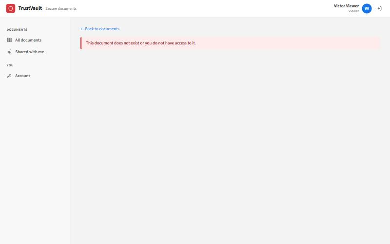
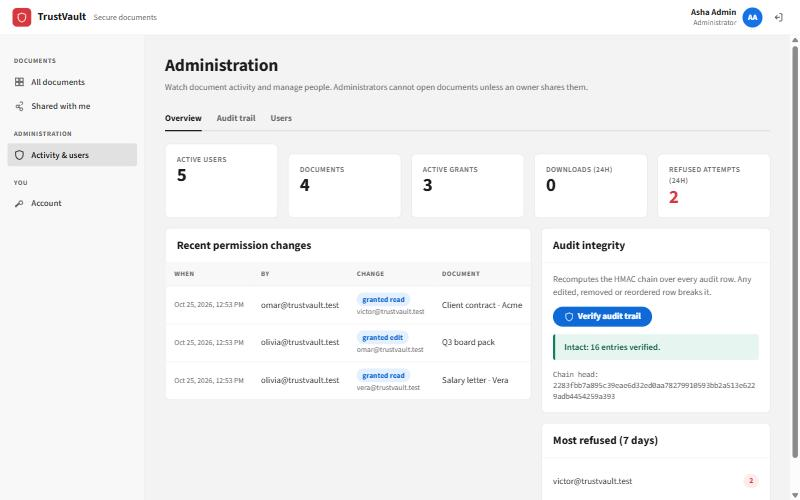
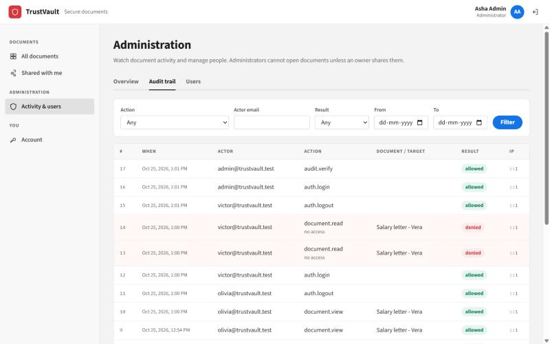

# TrustVault

A document platform where the wrong person cannot reach a document, and where you can prove who did.
Built for the Snovasys Fresher Hiring Challenge 2026.

- **Live site:** https://trustvault-76hy.onrender.com (free Render instance: the first request after a quiet spell can take ~50 seconds to wake up)
- **Threat model:** [THREATS.md](THREATS.md)
- **How I used AI, and where it was wrong:** [PROMPTS.md](PROMPTS.md)
- **API, with who may call each endpoint:** [API.md](API.md)
- **Write-up:** [WRITEUP.md](WRITEUP.md)

## Demo accounts

These are public on purpose so you can try every role. They exist only in the demo database.

| Role | Email | Password | What to try |
|---|---|---|---|
| Administrator | `admin@trustvault.test` | `AdminVault2026` | Activity & users: audit trail, refused attempts, verify the audit chain, deactivate a user |
| Document owner | `olivia@trustvault.test` | `OliviaVault2026` | Owns "Salary letter - Vera" (shared read with Vera) and "Q3 board pack" (shared edit with Omar) |
| Document owner | `omar@trustvault.test` | `OmarVault2026` | Owns "Client contract - Acme" (shared with Victor) and "Bridge drawings rev B" (shared with nobody) |
| Viewer | `vera@trustvault.test` | `VeraVault2026` | Can read the salary letter, nothing else |
| Viewer | `victor@trustvault.test` | `VictorVault2026` | Can read the Acme contract; try opening Olivia's documents by URL |

## What each role can do

| | Administrator | Document owner | Viewer |
|---|---|---|---|
| Sign in, change own password | ✓ | ✓ | ✓ |
| Upload new documents | ✗ | ✓ | ✗ |
| Read / download a document | only if shared with them | own + shared with them | only if shared with them |
| Edit details, upload new version | only with an *edit* grant | own + *edit* grants | only with an *edit* grant |
| Share, revoke, delete, restore, see who has access | ✗ | **own documents only** | ✗ |
| See the user directory (to share) | ✓ | ✓ | ✗ |
| Create users, change roles, deactivate | ✓ (not themselves) | ✗ | ✗ |
| Audit trail, activity summary, verify chain | ✓ | own documents' activity | ✗ |

**Permission model in one paragraph:** access is decided per document. The owner is the person who uploaded it.
They can grant **read** (view and download) or **edit** (also change details and upload new versions) to
named people, and take it back. Only the owner can share, delete or see who has access, so an editor cannot
pass the document on. Roles decide what you can do in the system (upload, administer), **never** which documents you
can open, so even the administrator cannot read a document unless its owner shared it. The decision is made
in one function, `authorizeDocument()` in [`server/src/authz.js`](server/src/authz.js), on every request, straight from
the database. Nothing is cached, so revoking access or deactivating a person works on their very next request.

## Run it on your machine

You need **Node.js 20 or newer** and git. No database install is needed: without `DATABASE_URL` the server runs
real PostgreSQL in-process ([PGlite](https://pglite.dev)) and seeds the demo accounts.

```bash
git clone <this repository> trustvault
cd trustvault
npm run build
npm start
```

Open **http://localhost:3000** and sign in with a demo account above.

- Data is in memory and resets when you stop the server. To keep it, set `PGLITE_DIR=./pgdata` before `npm start`.
- To use your own PostgreSQL instead, set `DATABASE_URL=postgresql://...`. Tables and demo data are created on first start.

### Run the tests

```bash
npm test
```

28 tests, covering each `T-xx` case in [THREATS.md](THREATS.md). They run against a fresh in-memory database.

```bash
npm run mutation-check
```

Removes 14 authorisation checks one at a time (download, details, edit, delete, share, search filter, upload
role, deleted documents, read→edit, edit→manage, admin routes, inactive users, CSRF header, file type check)
and fails if any removal still lets all tests pass. Takes a few minutes.

### Development mode (hot reload)

```bash
npm run install:all
npm run dev --prefix server
```

and in a second terminal:

```bash
npm run dev --prefix client
```

Open http://localhost:5173 (Vite forwards `/api` to the server on port 3000).

## Deploy (Render, free, no card)

1. On **Render**: New → Blueprint → connect this repository (or open
   `https://render.com/deploy?repo=<this repository's URL>`). Render reads [`render.yaml`](render.yaml).
2. Click **Apply**. Render creates:
   - `trustvault-db`: a PostgreSQL database that accepts **no connections from the internet**
     (`ipAllowList: []`), only from Render services;
   - `trustvault`: the web service, with `DATABASE_URL` wired to the database's internal address and a
     generated `AUDIT_HMAC_KEY`. Nobody types or sees a secret. Never change the key later, or old audit rows
     will no longer verify.
3. On first start the server creates the tables from [`server/src/schema.sql`](server/src/schema.sql) and the demo data.

Note: Render's free PostgreSQL expires 30 days after it is created. For longer use, switch the database
plan, or point `DATABASE_URL` at any other PostgreSQL (e.g. Neon).

Manual setup without the blueprint: Web Service, build command `npm run build`, start command `npm start`,
environment `NODE_ENV=production`, `DATABASE_URL=...`, `AUDIT_HMAC_KEY=<long random string>`.

To prepare a database by hand: `DATABASE_URL=... npm run db:setup --prefix server`.

### Environment variables

| Name | Required | Meaning |
|---|---|---|
| `DATABASE_URL` | in production | PostgreSQL connection string. If missing, an in-process PGlite database is used. |
| `AUDIT_HMAC_KEY` | in production | Secret for the audit hash chain. The server refuses to start in production without it. |
| `NODE_ENV` | | `production` turns on `Secure` cookies and requires the HMAC key. |
| `PORT` | | Default 3000. |
| `SEED` | | `false` to skip demo data on an empty database. |
| `PGLITE_DIR` | | Folder to keep the local PGlite database between restarts. |

## How it is built

```
server/                 Node.js + Express 5 API, also serves the built client
  src/authz.js          the ONE place document access is decided
  src/audit.js          append-only, HMAC-chained audit trail + verifier
  src/session.js        server-side sessions, role checks, CSRF header check
  src/files.js          upload validation (extension + magic bytes) and safe download headers
  src/schema.sql        database schema, including the trigger that blocks audit edits
  src/routes/           auth, documents (incl. sharing), admin, users
  src/seed.js           demo users and documents
  test/                 node:test + supertest, one test per THREATS.md entry
  scripts/mutation-check.mjs   proves the tests fail when a check is removed
client/                 React 19 + Vite, Spectrum-style UI (Source Sans 3)
```

Stack choices: Express because the request → check → response path is short and easy to explain. PostgreSQL
for transactions, row locks and triggers (the audit trail relies on them). Files are stored in the database
so there is no second place that needs access control. React only shows and hides buttons; **every** decision
is made again on the server.

## Screenshots

| | |
|---|---|
|  |  |
|  |  |
|  |  |

## What is not finished

See the end of [WRITEUP.md](WRITEUP.md) and the "Accepted" rows in [THREATS.md](THREATS.md). In short: no
groups or folders (on purpose), no external sharing, no AI sharing suggestions, no ownership transfer, no
retention or permanent purge, no MFA, and the audit chain's head is not anchored outside the database.
